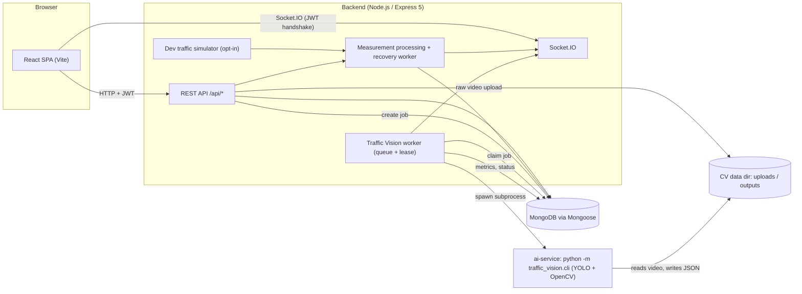

# Smart Traffic Management System (STM)

STM is a full-stack web application for urban traffic monitoring and management, built as a Software Engineering course project. Traffic authorities, traffic police, emergency services and citizens use one role-based dashboard to view traffic measurements, congestion events and alerts, adjust signal timing, give emergency vehicles signal priority, compare routes, and submit incident reports. A separate offline computer-vision service (**Traffic Vision**) analyses *recorded* video files to count and track vehicles.

> **Project status: active development, academic project.** STM is not production-hardened. Traffic data comes from API submissions, seeded test data, an optional development simulator, or recorded-video analysis. **There is no live camera or live traffic-feed integration.** See [Known limitations](#known-limitations-and-future-work).

## Contents

1. [Key features](#key-features)
2. [Architecture](#architecture)
3. [Technology stack](#technology-stack)
4. [Prerequisites](#prerequisites)
5. [Repository structure](#repository-structure)
6. [Installation and setup](#installation-and-setup)
7. [Environment variables](#environment-variables)
8. [Running the application](#running-the-application)
9. [User roles and permissions](#user-roles-and-permissions)
10. [API overview](#api-overview)
11. [Traffic Vision workflow](#traffic-vision-workflow)
12. [Traffic data processing and the development simulator](#traffic-data-processing-and-the-development-simulator)
13. [Testing and verification](#testing-and-verification)
14. [Database and test-data safety](#database-and-test-data-safety)
15. [Known limitations and future work](#known-limitations-and-future-work)
16. [Demo workflow](#demo-workflow)
17. [Troubleshooting](#troubleshooting)
18. [Development notes and license](#development-notes-and-license)

---

## Key features

Every item below is implemented in the code. "Verified" means checked by running the application, not just by reading code or running mocked tests; see [Testing and verification](#testing-and-verification).

| Area | What it does | Notes |
|---|---|---|
| **Authentication and roles** | JWT login (1-day expiry) and five roles enforced by the backend and mirrored in the UI navigation. | Public registration only creates `CITIZEN` accounts. |
| **Traffic monitoring** | Paginated traffic measurements, congestion events, monitoring devices and locations; Socket.IO notifications refresh the feeds. | Data is only as fresh as what was submitted or simulated. |
| **Congestion and alerts** | A `HIGH` or `SEVERE` measurement opens one congestion event and one alert per location; a `LOW` or `MEDIUM` reading clears them. Admin/Authority can also generate alerts manually. | Lifecycle rules are enforced by partial unique indexes. |
| **Signal optimization** | Admin/Authority pick a signal and a measurement; green time is set to 20, 30, 45 or 60 s from vehicle count and average speed. | Rule-based thresholds, not a predictive model. |
| **Emergency priority** | Admin/Emergency Service activate priority for a vehicle: the signal at its location goes to `NORTH_SOUTH` / 60 s, with the previous phase and green time saved; deactivation restores them. Signal optimization is refused (`409 EMERGENCY_OVERRIDE_ACTIVE`) while an override is active. | Activate/deactivate cycle checked manually once against the development database. |
| **Route recommendation** | Compares predefined routes between two locations. Ranks on live measurements only when every candidate route is fully covered by fresh readings; otherwise falls back to stored route data and labels it. | See [Route recommendation behaviour](#route-recommendation-behaviour). |
| **Citizen reporting** | Any signed-in user can file a report; Admin/Authority/Police review them. | |
| **Analytics** | Aggregated summary endpoint and dashboard / Alerts & Analytics views. | |
| **Traffic Vision** | Upload a recorded video, queue it, run YOLO detection (optional tracking) in a Python subprocess, and view metrics, history and downloads in the UI. | Recorded files only. |

## Architecture



- **Frontend** (`frontend/`): React 19 single-page app with React Router 7. It calls the REST API with a JWT and listens for Socket.IO notifications. The session is kept in memory; **a full page reload signs the user out**.
- **Backend** (`backend/`): Express 5 REST API, Socket.IO server, Mongoose models, business-logic services, a measurement-processing recovery worker, an optional development simulator and the Traffic Vision worker.
- **Database**: MongoDB (Atlas or local) through Mongoose.
- **AI service** (`ai-service/`): not a server. A Python CLI that the backend worker runs as a subprocess for each job. It reads a video file and writes a JSON result; it never touches the database or the API.
- **Data flow for traffic data**: a measurement is saved with `source` set to `API` (or `SIMULATOR`), then processed to detect congestion, create or clear events and alerts, and publish Socket.IO events. Traffic Vision results are stored on the job document and are **not** converted into traffic measurements.

## Technology stack

| Layer | Technology (versions from `package.json` / `requirements.txt`) |
|---|---|
| Frontend | React 19, React Router 7, Vite 8, ESLint 10, socket.io-client 4 |
| Backend | Node.js, Express 5, Mongoose 9 (MongoDB driver 7), Socket.IO 4, jsonwebtoken, bcryptjs, dotenv, cors; nodemon for development |
| Database | MongoDB |
| AI service | Python, Ultralytics 8.4.182 (YOLO, optional ByteTrack), opencv-python 4.12.0.88 |
| Tests | Node's built-in `node --test` (backend and frontend utilities), Python `unittest` |

## Prerequisites

- **Node.js** `^20.19.0` or `>=22.12.0` (required by the installed Vite 8 and Mongoose 9) and npm.
- **MongoDB**: a reachable instance (local or Atlas) and its connection string.
- **Python 3.10+** with `pip`, only if you want Traffic Vision (`ai-service/README.md` states 3.10 or newer; development used 3.11).
- **YOLO weights** (a `.pt` detection checkpoint), only for Traffic Vision. Weights and videos are not in the repository (they are git-ignored); obtain them separately.
- Git.

## Repository structure

```text
STM/
├── backend/
│   ├── server.js              # app wiring, route mounting, startup / shutdown
│   ├── config/                # database.js, trafficVision.js, routeTraffic.js
│   ├── controllers/           # request handlers (15)
│   ├── routes/                # Express routers (15)
│   ├── services/              # business logic, workers, simulator, realtime
│   ├── models/                # Mongoose models (12)
│   ├── middleware/            # authMiddleware.js (JWT + role checks)
│   ├── socket/                # Socket.IO server
│   ├── utils/                 # pagination.js
│   ├── scripts/               # seed-test-accounts, seed-test-data, migrate-congestion-lifecycle
│   └── tests/                 # node --test suites
├── frontend/
│   ├── src/pages/             # Home, TrafficMonitoring, SignalOptimization, EmergencyPriority,
│   │                          # RouteRecommendation, AlertsAnalytics, CitizenReporting, Login
│   ├── src/components/        # layout, common (Pager, ProtectedRoute), trafficVision
│   ├── src/config/roleAccess.js
│   ├── src/services/          # api.js, realtime.js, trafficVisionService.js
│   └── src/utils/             # helpers with node --test files
├── ai-service/
│   ├── traffic_vision/        # cli, detector, tracking, metrics, output, runner, validation
│   ├── tests/                 # unittest suites (synthetic detections)
│   ├── requirements.txt
│   └── README.md              # detailed CLI and metric definitions
├── simulator/                 # empty placeholder; the development simulator lives in
│                              # backend/services/trafficSimulatorService.js
└── README.md
```

## Installation and setup

```bash
git clone https://github.com/twhdd/STM.git
cd STM
```

**1. Backend**

```bash
cd backend
npm install
```

Create `backend/.env` (it is git-ignored; never commit it) from the [variables below](#environment-variables). At minimum:

```dotenv
PORT=5000
MONGO_URI=<your MongoDB connection string>
JWT_SECRET=<a long random string>
```

**2. Frontend**

```bash
cd frontend
npm install
```

Optional `frontend/.env`:

```dotenv
VITE_API_BASE_URL=http://localhost:5000/api
```

**3. AI service (only for Traffic Vision)**

```powershell
cd ai-service
python -m venv .venv
.venv\Scripts\activate
pip install -r requirements.txt
```

On macOS/Linux use `source .venv/bin/activate`. Then point the backend at this interpreter and at your weights with `STM_CV_PYTHON` and `STM_CV_MODEL_PATH`.

## Environment variables

All names below were found in the code. Do not commit real values.

### Core (backend `.env`)

| Variable | Purpose | Default |
|---|---|---|
| `MONGO_URI` | MongoDB connection string. **Required**; startup fails without it. | none |
| `JWT_SECRET` | Signing key for HS256 access tokens. **Required** for login and every authenticated request. | none |
| `PORT` | Backend HTTP port. | `5000` |
| `NODE_ENV` | `development` is required by the seed, migration and simulator tooling; those tools refuse `production`. | unset |
| `STM_TEST_DATABASE_NAME` | Database name to use. Must contain `test`. See [Database safety](#database-and-test-data-safety). | `stm_test` unless `NODE_ENV=production` |
| `STM_ROUTE_TRAFFIC_FRESHNESS_MS` | Maximum age of a measurement for route ranking to count it as fresh (1000 to 3600000). | `45000` |

### Frontend

| Variable | Purpose | Default |
|---|---|---|
| `VITE_API_BASE_URL` | API base URL (also used to derive the Socket.IO address). | `http://localhost:5000/api` |

### Traffic Vision (backend)

| Variable | Purpose | Default |
|---|---|---|
| `STM_CV_PYTHON` | Python executable used to run the CLI. | `python` |
| `STM_CV_MODEL_PATH` | Path to the YOLO weights (`.pt`). | unset |
| `STM_CV_DATA_DIR` | Root for `uploads/` and `outputs/`. | `<OS temp dir>/stm-cv-private` |
| `STM_CV_MAX_UPLOAD_BYTES` | Maximum upload size. | `524288000` (500 MB) |
| `STM_CV_TIMEOUT_MS` | Per-job subprocess timeout. | `1800000` (30 min) |
| `STM_CV_CONCURRENCY` | Jobs processed at once. | `1` |
| `STM_CV_QUEUE_CAPACITY` | Extra jobs allowed to wait. | `10` |
| `STM_CV_RETENTION_DAYS` | Days before stored files expire. | `7` |
| `STM_CV_POLL_INTERVAL_MS` | Worker polling interval. | `1000` |
| `STM_CV_DEVICE` | `auto`, `cpu` or a GPU index. | `auto` |
| `STM_CV_CONFIDENCE` | Detection confidence threshold. | `0.25` |

### Development tooling only (these gate writes; see the safety section)

`STM_TEST_DATA_CONFIRM`, `STM_TEST_ACCOUNTS_CONFIRM`, `STM_TEST_ACCOUNT_PASSWORD`, `STM_RUN_TRAFFIC_PROCESSING_INTEGRATION`, and the simulator settings `STM_TRAFFIC_SIMULATOR_ENABLED`, `STM_TRAFFIC_SIMULATOR_INTERVAL_MS` (default 15000, minimum 1000), `STM_TRAFFIC_SIMULATOR_DEVICE_COUNT` (default 3, range 1 to 20), `STM_TRAFFIC_SIMULATOR_SCENARIO` (default `normal`) and `STM_TRAFFIC_SIMULATOR_SEED`.

## Running the application

Use separate terminals.

| Component | Directory | Command | Address |
|---|---|---|---|
| Backend (auto-reload) | `backend/` | `npm run dev` | `http://localhost:5000` (health check: `GET /api/health`) |
| Backend (plain) | `backend/` | `npm start` | same |
| Frontend | `frontend/` | `npm run dev` | `http://localhost:5173` (Vite default) |
| Frontend production build | `frontend/` | `npm run build`, then `npm run preview` | `dist/` |
| AI service | n/a | Started automatically by the backend worker per job | n/a |

The frontend calls the API directly via `VITE_API_BASE_URL`; there is no dev proxy. The backend enables CORS for all origins.

You need user accounts to sign in. Public registration creates `CITIZEN` accounts; staff accounts come from an Admin (`POST /api/auth/users`) or from the development seed scripts, which **write to the database** (see [safety](#database-and-test-data-safety)). A fresh database has no Admin, so the steps below create the test accounts.

### First run on an empty test database

> **These steps write to MongoDB.** Run them only against a dedicated test database. The seed scripts refuse to run unless the guards below are set, and `seed:test-data` accepts only the database name `stm_test`. Neither script deletes or drops anything, and neither resets an existing password or role.

1. Start the backend once to confirm it connects: `npm run dev` in `backend/`, then open `http://localhost:5000/api/health`. Stop it again if you like; the seed scripts start their own temporary local server.
2. Create the five test accounts (one per role). In PowerShell, from `backend/`:

   ```powershell
   $env:NODE_ENV = "development"
   $env:STM_TEST_DATABASE_NAME = "stm_test"
   $env:STM_TEST_ACCOUNTS_CONFIRM = "YES"
   $env:STM_TEST_ACCOUNT_PASSWORD = "<choose a password: 16+ characters with lower, upper, digit and symbol>"
   npm run seed:test-accounts
   Remove-Item Env:STM_TEST_ACCOUNT_PASSWORD, Env:STM_TEST_ACCOUNTS_CONFIRM
   ```

   The accounts are `stm.admin.test@`, `stm.authority.test@`, `stm.police.test@`, `stm.emergency.test@` and `stm.citizen.test@example.com`. The script logs in as each one to verify it and prints no password. Setting the password in the shell session (not in `.env`) keeps it out of the repository. If `MONGO_URI` contains a database name, it must equal `STM_TEST_DATABASE_NAME`.
3. Optional, to populate the dashboards with sample locations, signals, devices, measurements, routes, vehicles, alerts and reports (the accounts must already exist):

   ```powershell
   $env:STM_TEST_DATA_CONFIRM = "YES"
   npm run seed:test-data
   Remove-Item Env:STM_TEST_DATA_CONFIRM
   ```

4. Start the backend (`npm run dev`) and the frontend (`npm run dev` in `frontend/`), open `http://localhost:5173` and sign in as `stm.admin.test@example.com` with the password you chose in step 2.

On macOS/Linux, set the same variables with `export NAME=value` and clear them with `unset NAME`. To skip seeding, register a `CITIZEN` account in the UI instead; it can use only the citizen pages.

## User roles and permissions

Roles: `ADMIN`, `TRAFFIC_AUTHORITY`, `TRAFFIC_POLICE`, `EMERGENCY_SERVICE`, `CITIZEN`. The backend enforces permissions per endpoint; the sidebar only hides pages.

| Capability | Admin | Authority | Police | Emergency | Citizen |
|---|:-:|:-:|:-:|:-:|:-:|
| Dashboard, Traffic Monitoring, Alerts & Analytics, Route Recommendation, Citizen Reporting pages | yes | yes | yes | yes | yes |
| Read measurements, events, alerts, routes, locations, analytics | yes | yes | yes | yes | yes |
| Read monitoring devices, traffic signals, emergency vehicles | yes | yes | yes | yes | no (403) |
| Submit traffic measurements | yes | yes | yes | no | no |
| Create locations, devices, signals, routes; set route waypoints | yes | yes | no | no | no |
| Optimize signals; generate alerts; trigger congestion detection | yes | yes | no | no | no |
| Activate / deactivate emergency priority; register emergency vehicles | yes | no | no | yes | no |
| File citizen reports | yes | yes | yes | yes | yes |
| Review citizen reports | yes | yes | yes | no | no |
| Create accounts with any role | yes | no | no | no | no |
| Submit and view Traffic Vision jobs | all jobs | all jobs | all jobs | own jobs | own jobs |

Pages a role may not open redirect to the dashboard. Traffic Vision lives in the Traffic Monitoring page ("Video AI Analysis" tab); the API is open to any authenticated user, with non-staff users restricted to their own jobs.

## API overview

All routes are under `/api` and need `Authorization: Bearer <token>` unless marked public. Paths and methods below were read from `backend/routes/*.js`; role rules are in the table above.

| Group | Endpoints |
|---|---|
| Health (public) | `GET /health` |
| Auth | `POST /auth/register` (public, CITIZEN only), `POST /auth/login` (public), `POST /auth/users` (Admin) |
| Traffic locations | `POST /traffic-locations`, `GET /traffic-locations`, `GET /traffic-locations/:id` |
| Monitoring devices | `POST /monitoring-devices`, `GET /monitoring-devices`, `GET /monitoring-devices/:id` |
| Traffic measurements | `POST /traffic-measurements`, `GET /traffic-measurements`, `GET /traffic-measurements/:id` |
| Congestion events | `POST /congestion-events/detect`, `GET /congestion-events`, `GET /congestion-events/:id` |
| Traffic alerts | `POST /traffic-alerts/generate`, `GET /traffic-alerts`, `GET /traffic-alerts/:id` |
| Traffic signals | `POST /traffic-signals`, `GET /traffic-signals`, `GET /traffic-signals/:id` |
| Signal optimization | `POST /signal-optimization/optimize` |
| Emergency vehicles | `POST /emergency-vehicles`, `GET /emergency-vehicles`, `GET /emergency-vehicles/:id` |
| Emergency priority | `POST /emergency-priority/activate`, `POST /emergency-priority/deactivate` (body: `vehicleId`) |
| Routes | `POST /routes`, `GET /routes`, `GET /routes/:id`, `PATCH /routes/:id/waypoints` |
| Route recommendation | `POST /route-recommendation/recommend` (body: `startLocation`, `endLocation`) |
| Analytics | `GET /traffic-analytics` |
| Citizen reports | `POST /citizen-reports`, `GET /citizen-reports`, `GET /citizen-reports/:id`, `PATCH /citizen-reports/:id/review` |
| Traffic Vision | `POST /traffic-vision/jobs`, `GET /traffic-vision/jobs`, `GET /traffic-vision/jobs/:id`, `.../results`, `.../annotated-video`, `.../result-file` |

**Pagination:** the measurement, congestion-event, alert and citizen-report lists accept `page` and `limit` (default limit 50, maximum 100, maximum page 10000). Invalid values return `400` with code `INVALID_PAGINATION`.

**Error conventions:** `401` for a missing or invalid token (the frontend then signs the user out), `403` for a valid token without permission, `409` for state conflicts (for example `PRIORITY_ALREADY_ACTIVE`, `PRIORITY_NOT_ACTIVE`, `EMERGENCY_OVERRIDE_ACTIVE`).

**Real-time events** (Socket.IO, JWT sent in the handshake, all authenticated users): `measurement-created`, `congestion-detected`, `congestion-cleared`, `alert-created`, `alert-resolved`, and `traffic-vision:status` for job updates. REST remains the source of truth if the socket is disconnected.

### Route recommendation behaviour

A route may carry an ordered list of `waypoints` (existing traffic locations). Live ranking is used **only when every candidate route has waypoints and fresh measurements (default window 45 s, last 24 h considered) at all of them**. In that case the worst fresh level along a route is used. In every other case (no waypoints, stale or missing data, partial coverage) the response uses `STATIC_ROUTE_DATA`: the stored `trafficLevel` and `estimatedTime` of each route, and the UI shows "Static route data — not live traffic". The seeded test routes have no waypoints, so a fresh checkout shows the static fallback. `PATCH /routes/:id/waypoints` (Admin/Authority) validates and sets the list (maximum 25, no duplicates, locations must exist; an empty list removes it).

## Traffic Vision workflow

Traffic Vision analyses **recorded video files**. It is not a live camera pipeline.

1. **Upload**: the UI (or `POST /api/traffic-vision/jobs`) sends the raw video as the request body with the headers `X-File-Name` and a video `Content-Type`; optional query flags `tracking` (default `true`) and `annotatedVideo` (default `false`); optional `Idempotency-Key` header. Accepted extensions: `.mp4`, `.mov`, `.avi`, `.mkv`, `.webm`, validated by extension, MIME type and file signature; maximum size 500 MB by default.
2. **Queue**: a job document is created (`QUEUED`) and the file is stored under the CV data directory. If the queue is full the request is rejected.
3. **Process**: the backend worker claims a job with a lease and heartbeat (`PROCESSING`) and runs `python -m traffic_vision.cli` from `ai-service/` with the configured weights. Failed or interrupted attempts are re-queued up to 8 attempts, after which the job is `FAILED`.
4. **Result**: the CLI writes a JSON file. On success the job becomes `COMPLETED` and stores metrics: detection events per class, frames processed, average detections per frame, processing time and FPS, and, with tracking, the number of distinct tracker IDs and active tracks. Lane-flow counting is only produced when a counting line is supplied to the CLI; the web upload does not supply one, so flow metrics are empty for UI jobs.
5. **View**: status updates arrive over Socket.IO (with a REST fallback for clients that connect late). The UI shows job history, metrics, optional annotated video and a JSON download.

Files expire after `STM_CV_RETENTION_DAYS`. **Detection events are not unique vehicles**, and tracker IDs are estimates. Results do not provide speed, density or road occupancy and are deliberately **not written as `TrafficMeasurement` records**. For CLI flags and metric definitions see [`ai-service/README.md`](ai-service/README.md).

Run the CLI directly (from `ai-service/`, with its virtual environment active):

```bash
python -m traffic_vision.cli --input path/to/video.mp4 --weights path/to/yolo.pt --output result.json --tracking
```

## Traffic data processing and the development simulator

- Each saved measurement is queued for durable processing (`PENDING` → `PROCESSING` → `COMPLETED`, with `RETRY` and a terminal `FAILED` after eight attempts, exponential backoff and per-location leases). A recovery worker resumes unfinished work after a restart. This internal state is not exposed through an API.
- At startup the backend checks for duplicate *active* congestion events or alerts before creating the unique indexes. If duplicates exist it logs them and **stops without changing any records**; `backend/scripts/migrate-congestion-lifecycle.js` is the operator-reviewed migration (dry run by default; `--apply` writes).
- **Simulator (development only, disabled by default):** generates measurements labelled `source: "SIMULATOR"` for existing active sensors, using scenarios `normal`, `rush-hour`, `heavy-congestion`, `incident` and `recovery`. It writes to the database, so it needs `NODE_ENV=development`, `STM_TRAFFIC_SIMULATOR_ENABLED=YES`, `STM_TEST_DATA_CONFIRM=YES`, a test database name, and a URI that matches it. It cannot tell whether a host is production, so only point it at a test cluster. Simulated data is not live traffic, and with the simulator off the stored data keeps ageing.

## Testing and verification

| Suite | Command (working directory) | Type | Needs |
|---|---|---|---|
| Backend | `npm test` (`backend/`) | Unit and mocked/in-process tests via `node --test`; they are not evidence of live database, browser or worker behaviour | Node. The one real-database suite is skipped unless enabled (below). |
| Backend real-database integration | `node --test tests/trafficMeasurementProcessing.integration.test.js` (`backend/`) | **Writes to MongoDB** | Opt-in: `STM_RUN_TRAFFIC_PROCESSING_INTEGRATION=YES`, `STM_TEST_DATA_CONFIRM=YES`, `NODE_ENV=development`, and a dedicated, empty test database whose name contains `test` (for example `stm_congestion_it_test`) set in `STM_TEST_DATABASE_NAME`. Do not use the shared `stm_test` database. |
| Frontend lint | `npm run lint` (`frontend/`) | Static analysis | Node |
| Frontend build | `npm run build` (`frontend/`) | Compile check | Node |
| Frontend utilities | `node --test src/utils/*.test.js` (`frontend/`) | Unit | Node |
| AI service | `python -m unittest discover -s tests -v` (`ai-service/`) | Unit with synthetic detections | Python and the installed requirements; no weights, network or GPU |

There is no browser/component test framework. Browser and end-to-end checks of the pages, Emergency Priority and Traffic Vision were done manually against the development database; they are not automated and the results are not recorded in the repository.

## Database and test-data safety

- The backend connects with an explicit `dbName`. Unless `NODE_ENV=production`, that name is `STM_TEST_DATABASE_NAME` or, if unset, **`stm_test`**, and it must contain `test` or startup fails. Consequently a database name written in `MONGO_URI` does not select the database in development; the explicit name does. With `NODE_ENV=production` and no `STM_TEST_DATABASE_NAME`, the URI's own database is used and this guard does not apply.
- The code can verify a database *name* but cannot tell whether a host is production. Use a dedicated test cluster.
- Commands that **write to the database**:

| Command | Effect | Guards |
|---|---|---|
| `npm run seed:test-accounts` | Creates or verifies one account per role | `NODE_ENV=development`, `STM_TEST_ACCOUNTS_CONFIRM=YES`, `STM_TEST_ACCOUNT_PASSWORD` (set at run time, never stored), matching test database name |
| `npm run seed:test-data` | Idempotently creates or updates sample locations, signals, devices, measurements, events, routes, vehicles, alerts and reports; does not delete or drop | `NODE_ENV=development`, `STM_TEST_DATABASE_NAME`, `STM_TEST_DATA_CONFIRM=YES`; the test accounts must already exist |
| `node scripts/migrate-congestion-lifecycle.js --apply` | Reconciles duplicate active congestion events/alerts | Refuses `NODE_ENV=production`; dry run without `--apply` |
| Backend with the simulator enabled | Inserts simulated measurements and the events/alerts they trigger | See the simulator section |
| Real-database integration suite | Creates and removes its own fixtures | See Testing |
| Normal application use | Every `POST`/`PATCH` in the API, including Traffic Vision uploads | Role checks |

Example (PowerShell, from `backend/`):

```powershell
$env:NODE_ENV = "development"
$env:STM_TEST_DATABASE_NAME = "stm_test"
$env:STM_TEST_DATA_CONFIRM = "YES"
npm run seed:test-data
Remove-Item Env:STM_TEST_DATA_CONFIRM
```

## Known limitations and future work

**Implemented but limited**

- **No live data sources.** Measurements are API-submitted, seeded or simulated. There are no sensor, GPS or CCTV integrations, and no real-time map.
- **Data staleness.** Dashboard counts and "active" events reflect whatever is stored. The "Live updates connected" label means the socket is connected, and the "Traffic Network Active" badge in the top bar is a static label; neither means the data is current.
- **Route ranking is live only with waypoints plus fresh data.** Otherwise it is static and labelled. Live ranking has not been exercised against real route-waypoint mappings in this project.
- **Signal optimization is rule-based** (fixed thresholds), and there is no prediction or forecasting.
- **Emergency priority** swaps one signal at the vehicle's current location to `NORTH_SOUTH` / 60 s and restores it; there is no multi-signal green corridor. A vehicle left active before the override-state feature existed (no saved state) is handled by a fallback that keeps the phase and resets green time to the schema default. That fallback path is covered by mocked tests only.
- **Traffic Vision** handles recorded video only, uses a general-purpose YOLO checkpoint without camera calibration, produces no speed or density, and its results do not feed the traffic measurements or alerts. Job processing was exercised end to end on one short sample video in development; accuracy on real footage has not been evaluated.
- **Authorization nuance:** Traffic Vision endpoints require only authentication (non-staff are limited to their own jobs).
- A page reload ends the session by design; there is no token refresh.
- No Docker, CI or deployment configuration is included, and `.github/` holds only an assistant-instructions file.

**Not implemented (ideas, not commitments)**: traffic prediction, live camera streams, IoT/sensor integration, external traffic-data feeds, multi-signal green corridors, richer route optimization.

## Demo workflow

No screenshots are included in the repository. A suggested walkthrough against a seeded test database:

1. Sign in as a staff user. Review the Dashboard and Traffic Monitoring (paginated measurements and events).
2. Open the "Video AI Analysis" tab to show a completed Traffic Vision job's metrics and history (uploading a new video takes tens of seconds and needs the AI service configured).
3. Show Alerts & Analytics and Citizen Reporting.
4. Run Route Recommendation and point out the "Static route data — not live traffic" label.
5. Optionally show Signal Optimization and Emergency Priority. Activating priority changes the stored signal until it is deactivated.
6. Navigate with the sidebar; a full page reload signs you out.

## Troubleshooting

| Symptom | Likely cause and action |
|---|---|
| Backend exits with "MONGO_URI environment variable is missing or empty" | Set `MONGO_URI` in `backend/.env`. |
| "STM_TEST_DATABASE_NAME must contain 'test'" | Rename the variable's value or unset it (development defaults to `stm_test`). |
| MongoDB TLS "alert 80", server selection timeout or authentication failure | The startup log prints a diagnostic: check Atlas Network Access (IP allow-list), network/firewall on port 27017, and credentials. |
| Startup stops after logging duplicate active congestion events/alerts | Existing data conflicts with the unique-index preflight. Nothing was changed; review and use the migration script (dry run first). |
| Every request returns 401 | `JWT_SECRET` missing or changed since the token was issued, or the token expired (1 day). Sign in again. |
| Frontend loads but API calls fail | Backend not running on the URL in `VITE_API_BASE_URL` (default `http://localhost:5000/api`). Check `GET /api/health`. |
| Signed out after refreshing | Expected: the session is not persisted across a full page load. |
| Dashboard shows old "active" events | The data is old and no simulator or feed is running. |
| Traffic Vision job fails or never starts | Check `STM_CV_PYTHON` points to an interpreter with the requirements installed, `STM_CV_MODEL_PATH` points to existing weights, the backend console for the subprocess error, and that the file type and size are within limits. Run the CLI by hand to isolate the problem. |
| Signal optimization returns 409 `EMERGENCY_OVERRIDE_ACTIVE` | The signal has an active emergency override; deactivate the priority first. |

## Development notes and license

- Before committing, run the backend tests, `npm run lint` and `npm run build` in `frontend/`, and the AI service tests if you changed it.
- Do not commit `.env` files, virtual environments, model weights, videos, `ai-service/test-assets/` or `backend/backups/`; they are git-ignored.
- Backend structure: route → controller → service → model; new endpoints should add a test in `backend/tests/`.
- Developed as a Software Engineering course project. The repository contains no license file; it is intended for academic and educational use.
